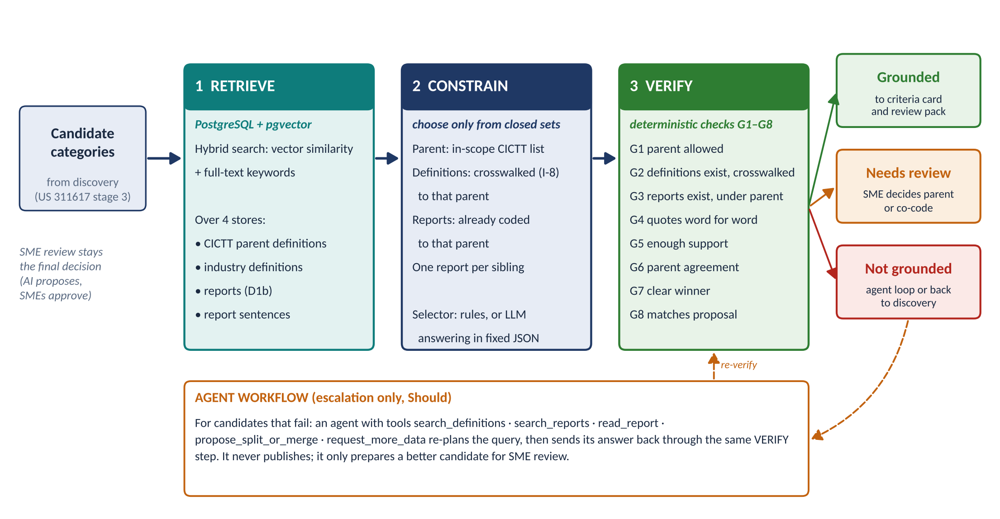
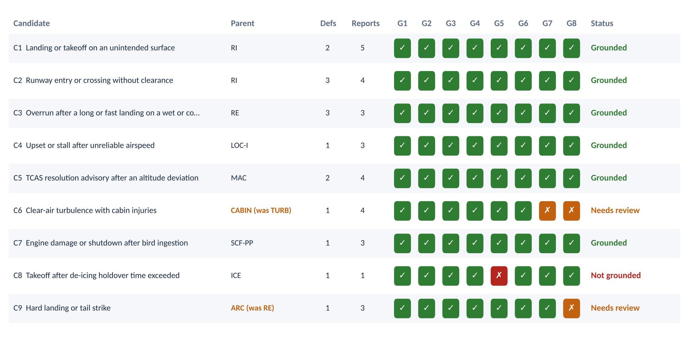

# Taxonomy Grounding Approach – ICAO Categories and Industry Definitions

*User Story (number to be confirmed) · Parent #311596: Taxonomy discovery pipeline*

| Item | Detail |
|---|---|
| **User story** | Investigate how to ground the taxonomy against ICAO categories and industry definitions (number to be confirmed) |
| **Parent** | #311596 – Taxonomy discovery pipeline |
| **Owner** | Bhairav Mehta (US) |
| **Status** | Draft for team review – the approach selection is marked DECISION |
| **Depends on** | A2, A4 and A6 (as listed in the story). The trial used stand-ins for their inputs (Section 9) |
| **Builds on** | US 311617 Taxonomy discovery pipeline requirements · US 311610 ICAO category reference · US 311613 industry taxonomy survey · US 313487 inputs and outputs |
| **Date** | November 3, 2026 |

## 1. Summary

Discovery (US 311617, stage 3) proposes new sub-categories from report text. Before an SME sees a proposal, it must be grounded: each candidate category must tie back to one ICAO/CICTT parent category, to the industry definitions it draws on, and to the reports that support it, with every link traceable to a stored record.

We compared three grounding approaches and recommend combining the first two with a deterministic check:

- Retrieve: search over definitions and reports in PostgreSQL with pgvector.
- Constrain: choose only from closed sets: the allowed parents, the definitions crosswalked to that parent, and reports already coded to it.
- Verify: eight automatic checks on every link.

Agent workflows are kept for escalation only, when a candidate fails.

A trial on 36 sample reports and 9 candidate categories showed the full chain working end to end in PostgreSQL 16 with pgvector 0.6.0:

- 8 of 9 parents chosen correctly.
- Report links matched the hand-labelled answer key with 97% precision and 97% recall.
- All six deliberately bad answers were blocked, including an invented definition and a paraphrased quote.
- Six candidates were grounded. Two went to SME review: one parent correction (RE → ARC) and one close call (TURB vs CABIN). One was rejected for too little support.

An extended synthetic test with 37 candidates and 309 reports (Section 6.6) found 35 of 37 parents correctly. All its wrong proposed parents, thin categories and ambiguous cases went to review or were blocked. It also showed that duplicate candidates from different batches must be merged before grounding.

The sample reports are synthetic and the set is small. These results show that the approach works, not how accurate it will be on real data; Section 7 lists the limits.

| The story asked for | Where |
|---|---|
| Grounding approach selected and documented | 3. Options · 4. Selected approach · 11. DECISION |
| Retrieval over definitions and reports (pgvector) | 4.1 Retrieve · 5. Data model |
| Constrained prompting | 4.2 Constrain · Appendix B |
| Agent workflows | 3. Options · 4.4 Escalation |
| Trial: category → ICAO parent → industry definitions → supporting reports | 6. Trial · Figures 2 and 3 · Appendix A |
| Extended test and reviewer tools | 6.6 Extended test · 6.7 Tools (viewer, interactive mode) |

## 2. What "grounded" means

A candidate category is grounded when every link in its chain points to a stored, versioned record and passes the checks in Section 4.3. Nothing in the chain is free text written by the model, except the evidence quotes, and those must match the report word for word.

| Link | Ties the candidate to | Rule |
|---|---|---|
| **ICAO parent** | One CICTT Level 1 category (D2 level 1) | Chosen only from the in-scope list in US 311617 Section 9. Co-code-only categories (ATM, MED) cannot be parents |
| **Industry definitions** | 0–3 definitions from the survey (US 311613), e.g. ICAO Doc 9870, FAA, ASRS, SKYbrary, EUROCONTROL | Only definitions whose SME-approved crosswalk (I-8) lists that parent |
| **Supporting reports** | Report records (D1b) | Only reports already coded to that parent in stage 2; each with an exact evidence sentence; one report supports one sibling only |

## 3. Options considered

| Option | How it works | Strengths | Weaknesses |
|---|---|---|---|
| **A. Retrieval over definitions and reports (pgvector)** | Store parents, definitions, reports and report sentences as vectors next to full-text indexes; find the closest records for each candidate | Every link is a real record with an ID; runs inside the existing PostgreSQL; cheap; repeatable | Similarity alone cannot tell "related" from "same thing"; needs a good embedding model |
| **B. Constrained prompting** | An LLM reads only the retrieved records and must answer in fixed JSON, choosing parent, definitions and reports from closed lists, quoting evidence exactly | Reads meaning (e.g. rejects a TCAS event caused by ATC from an "altitude deviation" category); explains concerns | Can still invent ids or paraphrase quotes unless checked; model and prompt must be versioned and approved |
| **C. Agent workflows** | An LLM agent plans its own searches with tools, reads reports, and proposes splits or merges | Handles hard cases: thin evidence, wrong parent, overlapping siblings | Harder to audit and reproduce; more cost; risk of drift if allowed to publish |
| **Deterministic checks (used with all)** | Code checks every link: ids exist, parent allowed, crosswalk respected, quotes exact, enough support | Catches invented or wrong links with certainty; same rules for any model | Cannot judge meaning on its own |

| Criterion | A Retrieval | B Constrained prompting | C Agent |
|---|---|---|---|
| **Traceability to stored records** | High | High, with checks | Medium |
| **Judges meaning, not just similarity** | Low | High | High |
| **Repeatable and auditable** | High | Medium (version model and prompt) | Low–medium |
| **Cost and effort** | Low | Medium | High |
| **Fits SME-approval gate (EASA Level 1 human assistance)** | Yes | Yes | Only if it cannot publish |

*Recommendation: A + B with deterministic checks for every candidate; C only for candidates that fail (escalation). Fine-tuning a classifier (US 311617, DM-5) stays a later option for routine assignment at scale.*

## 4. Selected approach: retrieve, constrain, verify



*Figure 1. The grounding approach. Every candidate goes through retrieval, constrained selection and verification. Grounded candidates go on to criteria cards and SME review; the rest go to SME review or to an agent loop that must pass the same checks.*

### 4.1 Retrieve

All grounding data lives in PostgreSQL with the pgvector extension, next to the pipeline's other tables. Each search combines vector similarity with keyword ranking, because domain terms (taxiway, holdover, TCAS) matter as much as meaning.

| Store | What is searched |
|---|---|
| **CICTT parents** | Code, name and definition for every in-scope Level 1 category, with version |
| **Industry definitions** | Term, definition text, source and crosswalked parents |
| **Reports** | Narrative and source codes, with the stage-2 multi-label Level 1 codes |
| **Report sentences** | One vector per sentence, so evidence can be quoted exactly |

Hybrid score = 0.6 × vector cosine + 0.4 × keyword rank (PostgreSQL full text, normalised within the query). Results are kept when they score at least 40% of the best match and above a floor of 0.15. Relative cut-offs are used because absolute similarity scales differ from query to query.

### 4.2 Constrain

| Choice | Constraint |
|---|---|
| **Parent** | From the in-scope CICTT list only. Score = 0.3 × fit to the parent's definition + 0.7 × share of the closest reports already coded to that parent. The evidence vote is weighted higher because it proved more reliable in the trial (Section 6.3) |
| **Definitions** | Only those crosswalked to the chosen parent; up to 3 |
| **Reports** | Only those coded to the chosen parent; up to 8; evidence sentence chosen by vector and stemmed keyword match |
| **Siblings** | A report supports only the sibling candidate it matches best; others lose it, and the move is recorded |

The selector can be deterministic rules (used for every candidate in the trial) or an LLM that receives the retrieved records through the constrained prompt (Appendix B) and must reply in the fixed JSON schema. Either way, the result goes through the same checks.

### 4.3 Verify

| ID | Check | If it fails | What it catches |
|---|---|---|---|
| **G1** | Parent is an allowed, in-scope CICTT category | Not grounded | Invented or out-of-scope parents |
| **G2** | Definitions exist and are crosswalked to the parent | Not grounded | Invented definitions; definitions from another branch |
| **G3** | Every report exists and is coded to the parent | Not grounded | Invented report keys; evidence from another branch |
| **G4** | Every evidence quote appears word for word in its report | Not grounded | Paraphrased or made-up evidence |
| **G5** | At least the minimum number of supporting reports (3 in the trial; 10 in production, as in US 311617) | Not grounded | Categories with too little evidence |
| **G6** | At least 60% of the closest reports sit under the parent | Needs review | Candidates whose evidence mostly lives elsewhere |
| **G7** | The parent beats the runner-up by at least 0.10 | Needs review | Close calls between two parents (multi-label cases) |
| **G8** | The parent matches the one proposed by discovery | Needs review | Parent corrections that an SME should confirm |

### 4.4 Outcomes and escalation

| Outcome | What happens next |
|---|---|
| **Grounded** | The chain goes onto the criteria card (US 311617 stage 4) and into the SME review pack (O-5) |
| **Needs review** | Goes to SMEs with the reason (for example "parent changed from RE to ARC" or "TURB and CABIN both fit") |
| **Not grounded** | Goes to the agent loop (Should), or back to discovery with the reason; never to publication |

The agent loop is limited by design:

- Tools only: search definitions, search reports, read a report, propose a split or merge, ask for more data.
- Bounded: at most 5 tool calls per candidate, with every call logged.
- Re-checked: its answer must pass G1 to G8 again.
- Never publishes: it only prepares a better candidate for SME review.

## 5. Data model (PostgreSQL + pgvector)

| Table | Holds | Links to |
|---|---|---|
| **icao_category** | CICTT code, name, definition, in-scope flag, co-code-only flag, version, vector | D2 level 1 (US 313487) |
| **industry_definition** | Id, source, term, text, crosswalked parents, version, vector, full-text index | I-2, I-8 |
| **report** | Report key, source, phase, stage-2 Level 1 codes, narrative, vector, full-text index | D1b, D3 |
| **report_sentence** | Report key, sentence number, sentence, vector | Evidence quotes |
| **candidate** | Candidate id, name, definition, proposed parent, vector | Discovery output (proposed D2) |
| **grounding_result** | Run, candidate, parent, parent changed, status, all check results | O-5 review packs, O-8 |
| **grounding_link** | Run, candidate, link type (parent / definition / report), target id, score, evidence quote | Criteria cards; audit trail (O-9) |

For large report volumes add approximate nearest-neighbour indexes (HNSW) on the report and sentence vectors. Every run records the embedding model and prompt version (I-9) and the settings used.

## 6. Trial

### 6.1 Set-up

| Item | Trial value |
|---|---|
| **Database** | PostgreSQL 16.15 with pgvector 0.6.0 |
| **Parents** | 14 CICTT Level 1 categories (13 can be parents; ATM is co-code only), definitions paraphrased |
| **Industry definitions** | 18, paraphrased from ICAO Doc 9870, FAA Runway Safety, NASA ASRS coding taxonomy, SKYbrary, IATA, ICAO Annex 10, EUROCONTROL, FAA AC 120-88A, FAA wildlife strike database, 14 CFR 33.76, FAA holdover time guidelines and the ICAO Global Reporting Format, each crosswalked to its parents |
| **Reports** | 36 synthetic reports written for the trial, each with stage-2 Level 1 codes, including distractors (veer-off, wake turbulence, ATC-caused conflict, bird strike without engine damage) |
| **Candidates** | 9 proposed sub-categories under RI, RE, LOC-I, MAC, TURB, SCF-PP and ICE. Two are weak on purpose: C8 has one supporting report, and C9 was proposed under the wrong parent (RE instead of ARC) |
| **Answer key** | Expected parent and expected supporting reports for each candidate, labelled by hand |
| **Embedding** | Local stand-in (TF-IDF reduced to 64 dimensions), because no embedding model could be downloaded in the build environment |
| **Settings** | As in Section 4; minimum support 3 because the sample is small |

### 6.2 Results


*Figure 2. One grounded chain from the trial: candidate C1 → ICAO parent RI → two crosswalked industry definitions → five supporting reports with exact evidence quotes. The two hold-short reports retrieved for C1 were given to its sibling C2, which they match better.*



*Figure 3. Trial results for all nine candidates: chosen parent, number of definitions and reports, the eight checks, and the status. Orange checks send the candidate to SME review; red checks block it.*

| Measure | Rules selector | Constrained-prompt answers |
|---|---|---|
| **Parents correct (of 9)** | 8 | 9 |
| **Report links – precision** | 97% (29 of 30) | 100% (29 of 29) |
| **Report links – recall** | 97% (29 of 30) | 97% (29 of 30) |
| **Grounded / needs review / not grounded** | 6 / 2 / 1 | 6 / 2 / 1 |
| **Links stored in the database** | 9 parent, 15 definition, 30 report links | 9 parent, 16 definition, 29 report links |

The constrained-prompt answers were written in this session by the assistant, from the filled prompts and only the retrieved records in them. The same assistant also wrote the answer key, so this column shows that the constrained prompt and the verifier work together; it is not an independent accuracy measure. Section 10 sets out the independent run with the approved model.

### 6.3 Parent selection: definitions alone are not enough

| How the parent is chosen | Correct (of 9) | Misses |
|---|---|---|
| **Fit to the parent definition only** | 6 | C4 (chose SCF-NP for an airspeed upset), C5 (chose NAV for a TCAS event), C6 |
| **Vote of the closest reports only** | 8 | C6 |
| **Combined (selected)** | 8 | C6 – flagged for review, not missed silently |

Grounding against the reports' own codes adds most of the accuracy. Definition fit is kept as a tie-breaker and as a check that the parent makes sense.

### 6.4 Guardrails: what the checks stop

Each test takes the grounded answer for C1 and adds one fault that an unconstrained model might produce.

| Bad answer | Result | Check that caught it |
|---|---|---|
| **Parent not in the allowed list ("RUNWAY-SAFETY")** | Not grounded | G1, and G2, G3, G5 as a result |
| **Invented definition id (IND-99)** | Not grounded | G2 |
| **Definition from another parent (runway excursion)** | Not grounded | G2 |
| **Paraphrased evidence quote** | Not grounded | G4 |
| **Report from another parent (a veer-off)** | Not grounded | G3 |
| **Invented report key** | Not grounded | G3 |

### 6.5 Findings

| Candidate | Finding |
|---|---|
| **C1, C2 (RI siblings)** | Both grounded. The hold-short reports first matched both siblings; the sibling rule gave them to C2 only. Overlap between siblings is common and must be resolved before review |
| **C5 (MAC)** | Rules selector included SAMPLE-022, a TCAS advisory caused by an ATC clearance, not an altitude deviation. The checks cannot catch this because it is a matter of meaning; the constrained-prompt answer excluded it and suggested a sibling category for ATC-induced conflicts |
| **C3 (RE)** | Both selectors left out SAMPLE-012, an overrun on a contaminated runway that does not say the landing was long or fast. The constrained-prompt answer flagged it as a scope question for SMEs |
| **C6 (TURB)** | TURB and CABIN fit almost equally (every report carries both codes). Flagged for review with CABIN suggested as a co-code – the right outcome for a multi-label case |
| **C9 (proposed under RE)** | Grounding moved it to ARC (hard landing, tail strike) and flagged the change for SME confirmation |
| **C8 (ICE)** | Only one supporting report: not grounded, as intended |

*The first run used fixed thresholds and scaled definition fit so that the top parent always scored 1. It grounded only 2 of 9 candidates, because similarity scales differ between queries. Relative cut-offs, an evidence-weighted parent score and the sibling rule fixed this. The settings were tuned once on this sample and must be set again on SME-labelled test sets (I-10).*

### 6.6 Extended test: 37 candidates

The first trial was small. Two more synthetic runs tested the approach at a larger scale, on harder cases.

- Sample B: 28 new candidates (B01–B28) and 273 reports, generated from templates by tools/generate_sample_b.py.
- Combined set: Sample B merged with the trial, giving 37 candidates and 309 reports.

| Item | Sample B |
|---|---|
| **Reports** | 273 synthetic reports. 213 support candidates and 60 are background reports from 20 templates, including near-misses such as a TCAS traffic advisory with no resolution advisory. About 30% use ASRS-style shorthand (rwy, FO, ATC) |
| **Parents and definitions** | 20 parents: the 14 from the trial plus RAMP, F-NI, FUEL, WSTRW, USOS and the OTHR holding pool. 41 industry definitions; IND-19 to IND-41 are paraphrased from FAA, ICAO, EASA, IATA and SKYbrary sources |
| **Planted hard cases** | Two candidates proposed under the wrong parent (B13, B23). Two thin categories (B14, B28). Sibling categories (B01/B02/B27, B15/B16). Multi-coded reports (B15, B17, B18). Eight stage-2 labelling errors. An emerging category partly held in OTHR (B12) |
| **Settings** | As in the trial, except at most 12 supporting reports per candidate (--max-reports 12), because several candidates have 8–10 true reports |

| Measure | Trial (9) | Sample B (28) | Combined (37) |
|---|---|---|---|
| **Parents correct** | 8 | 27 | 35 |
| **Report links – precision** | 97% | 93% | 83% (89% counting overlaps) |
| **Report links – recall** | 97% | 90% | 79% (84% counting overlaps) |
| **Grounded / needs review / not grounded** | 6 / 2 / 1 | 20 / 6 / 2 | 23 / 9 / 5 |
| **Guardrail tests blocked** | 6 of 6 | 6 of 6 | 6 of 6 |
| **Parent by definition fit only / report vote only** | 6 / 8 | 18 / 26 | 26 / 34 |

| Finding | Detail |
|---|---|
| **Wrong proposed parents corrected** | B13 was moved from SCF-NP to SCF-PP and B23 from TURB to WSTRW. Both were flagged by G8 for SME confirmation |
| **Thin categories blocked** | B14 and B28 have two valid reports each and were not grounded (G5) |
| **Ambiguous cases sent to review, not decided silently** | B05 (go-around stall, close to unreliable-airspeed and low-fuel go-around reports) failed G6 and G7. B07 (ATC-caused loss of separation, coded MAC and ATM) failed G6. B15 (bird ingestion, coded BIRD and SCF-PP) failed G7. B17 (battery fire, coded F-NI and CABIN) was a genuine tie and was grounded under CABIN with G7 and G8 flags |
| **Labelling errors lower recall** | Reports mislabelled OTHR or LOC-I at stage 2 cannot be linked, because G3 only allows reports coded to the parent. This is by design: these reports need recoding, not a looser check |
| **Duplicate candidates across batches** | Eight trial candidates describe the same events as Sample B candidates: C1/B02, C2/B01/B27, C3/B04, C4/B26, C5/B08, C7/B15, C8/B14 and C9/B22. In the combined run the sibling rule splits their reports, so C1, C3, C7 and B01 drop to not grounded. The "counting overlaps" score does not count a report given to the overlapping candidate as an error. Discovery must merge duplicate candidates before grounding |
| **Mixed report styles** | In the combined set, the longer hand-written trial reports outscore the shorter template reports. The relative cut-off then drops some correct template reports (for example most of B01's). Real data will mix sources in the same way; the cut-off must be tuned on a mixed SME-labelled sample (I-10) |
| **Parent selection** | The result from the trial holds at scale. Definition fit alone picks the right parent for only 26 of 37 candidates; using the reports' codes raises this to 35 |

### 6.7 Tools for reviewers

- Grounding Trial Viewer: a single HTML page with all 37 candidates built in. It shows each grounding chain, the check matrix, the guardrail tests and parent selection, and can load any run's outputs with Load results. Its Try a candidate tab takes a typed candidate through the five steps in the browser, step by step, with sliders for the main settings.
- Interactive mode: interactive.py does the same with the exact pipeline in pgvector. It prints each step and saves the results for the viewer.

## 7. What the trial shows, and what it does not

- Shows: the whole chain can be built and stored in pgvector, every link resolves to a record, the checks block invented or misplaced links, and weak or misplaced candidates are routed to SMEs rather than published.
- Does not show accuracy on real data. The 36 reports are synthetic, short and clean; real narratives are longer and messier.
- Small and tuned. Nine candidates in the trial, with settings tuned once on the same sample. The extended test (37 candidates, Section 6.6) is larger, but its reports are also synthetic and template-generated.
- Stand-in embeddings. The local vectors are much weaker than an aviation-trained model; real retrieval should be better, but must be measured.
- Paraphrased definitions. Production must load official CICTT text (US 311617, IN-2) and the official industry sources.
- Constrained-prompt answers were not independent (Section 6.2).

## 8. Requirements

| ID | Requirement | Priority |
|---|---|---|
| **GR-1** | Every candidate category is grounded (status recorded) before it enters an SME review pack. | Must |
| **GR-2** | The parent comes only from the in-scope CICTT list; co-code-only categories cannot be parents. | Must |
| **GR-3** | Industry definitions are linked only through the SME-approved crosswalk (I-8). | Must |
| **GR-4** | Every supporting report is coded to the parent and has an evidence quote that matches the report word for word. | Must |
| **GR-5** | A candidate needs at least 10 supporting reports to be grounded (US 311617 minimum size). | Must |
| **GR-6** | A report supports only one sibling candidate; moves are recorded. | Must |
| **GR-7** | All LLM output passes the same checks (G1–G8) as rule-based output; nothing bypasses them. | Must |
| **GR-8** | Every run records the embedding model, LLM, prompt version and settings (I-9). | Must |
| **GR-9** | Grounding data and indexes live in the approved PostgreSQL with pgvector; hybrid vector and keyword search. | Must |
| **GR-10** | Parent choice uses both definition fit and the codes of the closest reports. | Should |
| **GR-11** | Agent escalation is limited to listed tools and 5 calls per candidate, is logged, and cannot publish. | Should |
| **GR-12** | Each release reports grounding precision and recall against SME-labelled test sets, as part of O-8. | Should |

## 9. Dependencies

The story depends on A2, A4 and A6. Grounding needs the three inputs below; the trial used stand-ins for each. Which of A2, A4 and A6 provides which input is to be confirmed.

| Input grounding needs | Used for | Stand-in in the trial |
|---|---|---|
| Report extracts with stage-2 Level 1 codes (data-source review, pipeline stages 1–2) | Reports and sentences; parent vote; evidence | 36 synthetic reports |
| Machine-readable CICTT definitions (US 311617, IN-2) | Parent list and parent fit | 14 paraphrased CICTT definitions |
| Industry definitions and crosswalk (US 311613 survey, I-8) | Definition links | 18 paraphrased definitions with crosswalk |

## 10. Next steps

- Merge duplicates first: add a candidate de-duplication step at the end of discovery, so near-identical candidates from different batches are merged before grounding (Section 6.6).
- Real sample: rerun on about 500 real reports (NTSB and ASRS public data first, P0) with SME-labelled expected categories, using the toolkit as delivered.
- Embeddings: compare an aviation model (SafeAeroBERT) with a general model on the same sample, if either is available in the approved environment (US 311617, DM-1).
- Independent LLM run: run the constrained prompt with the approved model (for example run_trial.py --llm codex) and compare it with the rules selector on the same answer key.
- Settings: set the cut-offs, weights and margins on SME-labelled test sets (I-10); raise minimum support to 10.
- SME review: review the grounding cards for the real sample with the safety SME lead and agree the crosswalk (I-8).

## 11. Decisions needed (DECISION)

| ID | Decision | Options | Recommendation |
|---|---|---|---|
| **DG-1** | Grounding approach | A retrieval · B constrained prompting · C agent · combinations | A + B with deterministic checks G1–G8; C for escalation only |
| **DG-2** | Embedding model | Aviation-trained (SafeAeroBERT) · general model · company-approved model | Decide after the comparison in step 2, on recall of SME-labelled links |
| **DG-3** | LLM for constrained prompting | Company-approved model service (as in US 313488, DA-3) | Same approved service as the rest of the pipeline, called through the model registry |
| **DG-4** | Minimum support to ground a category | 5 · 10 · 20 reports | 10, matching the US 311617 minimum category size |

## 12. Open items

| Item | Owner | Needed by |
|---|---|---|
| Confirm which of A2, A4, A6 provides each input in Section 9 | Story owner | Before the real-sample trial |
| Approved PostgreSQL with pgvector for the team | Platform / IT owner | Before the real-sample trial |
| SME-labelled sample of about 500 reports | Safety SME lead | Before the real-sample trial |
| SME approval of the crosswalk from industry definitions to CICTT parents (I-8) | Safety SME lead | Before the real-sample trial |
| Official CICTT v4.8 text loaded (IN-2) | Story owner | Before the real-sample trial |
| Approved embedding model and LLM available in the environment | Platform / IT owner, InfoSec | Before steps 2 and 3 |

## 13. References

- US 311617 – Taxonomy discovery pipeline requirements (stages, minimum size, DM-1 to DM-6). US 311610 – ICAO category reference. US 311613 – industry taxonomy survey. US 313487 – inputs and outputs (D1b, D2, D3, I-8, I-9, O-5, O-8, O-9). US 313488 – architecture (DA-3).
- pgvector – open-source vector similarity search for PostgreSQL: https://github.com/pgvector/pgvector
- PostgreSQL full text search: https://www.postgresql.org/docs/current/textsearch.html
- Lewis et al., Retrieval-Augmented Generation for Knowledge-Intensive NLP Tasks (2020): https://arxiv.org/abs/2005.11401
- Yao et al., ReAct: Synergizing Reasoning and Acting in Language Models (2022): https://arxiv.org/abs/2210.03629
- Wan et al., TnT-LLM (KDD 2024): https://dl.acm.org/doi/pdf/10.1145/3637528.3671647 · Tamkin et al., Clio (2024): https://arxiv.org/pdf/2412.13678 · Pham et al., TopicGPT: https://arxiv.org/pdf/2311.01449v2
- SafeAeroBERT (NASA, AIAA Aviation 2023): https://ntrs.nasa.gov/api/citations/20240003131/downloads/2023_AIAA_Aviation_SafeAeroBERT.pdf
- CICTT occurrence categories (ICAO-hosted copy): https://www.icao.int/sites/default/files/APAC/Meetings/2024/2024%20NASP%20Workshop/Supporting%20Documents/CAST-ICAO-Taxonomy-Occurrences.pdf
- EASA Artificial Intelligence Concept Paper Issue 2: https://www.easa.europa.eu/en/document-library/general-publications/easa-artificial-intelligence-concept-paper-issue-2 · NIST AI RMF 1.0: https://nvlpubs.nist.gov/nistpubs/ai/NIST.AI.100-1.pdf

## Appendix A. Grounding chains from the trial (rules selector)

| Candidate | Parent | Industry definitions | Supporting reports | Status |
|---|---|---|---|---|
| C1 Landing or takeoff on an unintended surface | RI | IND-03 Wrong-surface event; IND-04 Anomaly: Ground Incursion – Runway or Taxiway | S-001, S-002, S-005, S-003, S-004 | grounded |
| C2 Runway entry or crossing without clearance | RI | IND-04 Anomaly: Ground Incursion – Runway or Taxiway; IND-01 Runway incursion; IND-03 Wrong-surface event | S-009, S-007, S-006, S-008 | grounded |
| C3 Overrun after a long or fast landing on a wet or contaminated runway | RE | IND-07 Anomaly: Ground Excursion – Runway; IND-06 Runway condition code (RWYCC); IND-05 Runway excursion (veer-off and overrun) | S-010, S-013, S-011 | grounded |
| C4 Upset or stall after unreliable airspeed | LOC-I | IND-09 Unreliable airspeed | S-015, S-018, S-017 | grounded |
| C5 TCAS resolution advisory after an altitude deviation | MAC | IND-11 Level bust (altitude deviation); IND-10 Resolution advisory (RA) | S-021, S-019, S-020, S-022 | grounded |
| C6 Clear-air turbulence with cabin injuries | CABIN (proposed TURB) | IND-14 Turbulence-related injuries | S-025, S-026, S-023, S-024 | needs review |
| C7 Engine damage or shutdown after bird ingestion | SCF-PP | IND-16 Engine bird ingestion | S-031, S-028, S-029 | grounded |
| C8 Takeoff after de-icing holdover time exceeded | ICE | IND-17 Holdover time | S-032 | not grounded |
| C9 Hard landing or tail strike | ARC (proposed RE) | IND-18 Hard landing, tail strike | S-034, S-036, S-035 | needs review |

*Report keys shortened: S-001 = SAMPLE-001. The full chains with every evidence quote are in out/grounding_cards.md in the toolkit.*

## Appendix B. Constrained prompt and output format

The prompt is filled for each candidate with the retrieved records only (allowed parents, top industry definitions, top reports). The model must reply with JSON in this shape; every field is then checked (G1–G8).

```
{
  "candidate_id": "C5",
  "parent_code": "MAC",                      <- one code from the allowed list, or NONE
  "definition_ids": ["IND-11", "IND-10"],    <- only from the retrieved list
  "supporting_reports": [
    {"report_key": "SAMPLE-019",
     "evidence": "The climbing aircraft overshot its cleared altitude of FL240 by 400 feet, and ..."}
  ],
  "concerns": "SAMPLE-022 is a TCAS resolution advisory caused by an ATC clearance ..."
}
```

Prompt rules: use only the context given; choose exactly one allowed parent; choose definitions only from the retrieved list and only if crosswalked to the parent; quote evidence word for word; include only reports that clearly match; state concerns about weak evidence or a wrong proposed parent.

## Appendix C. Toolkit

| File | What it is |
|---|---|
| **run_trial.py** | Runs the trial: loads data into pgvector, grounds every candidate, verifies, scores, writes results. Options --db, --data, --out, --max-reports, --min-support, --model, --prompts-only, --llm codex, --llm-outputs |
| **grounding.py** | Embedders, PostgreSQL/pgvector store, hybrid retrieval, constrained selection, sibling rule, verifier G1–G8, prompt builder |
| **db/schema.sql** | The seven tables in Section 5 |
| **prompts/** | Constrained prompt and JSON schema |
| **data/** | Parents, industry definitions with crosswalk, synthetic reports, candidates with the answer key |
| **make_figures.py** | Figures 1–3; a chain figure for any candidate |
| **interactive.py** | Interactive mode: type a candidate and follow it through the five steps; results load into the viewer |
| **tools/generate_sample_b.py** | Generates Sample B, or any new seeded synthetic sample (--seed, --scale, --background) |
| **tools/combine_datasets.py** | Merges data folders (for example the trial and Sample B) and records overlapping candidates |
| **viewer/grounding_viewer.html** | Grounding Trial Viewer, with the 37-candidate combined run built in |
| **data_sample_b/, data_combined/** | Sample B and the combined dataset |
| **out_sample_b/, out_combined/** | Results of the Sample B and combined runs |
| **out/** | Results of the trial runs: grounding table, cards, parent selection, guardrail tests, prompts and answers |
